<div align="center">

# 🌿 neemSEO

**100% Free, Open-Source, and Self-Hostable SEO Platform.**

Professional SEO intelligence designed for modern engineering teams, founders, and autonomous AI agents.  
No subscriptions. No credit card required. No login barriers.

[](https://github.com/Ibrahist/neemSEO/actions/workflows/ci.yml)
[](https://github.com/Ibrahist/neemSEO/actions/workflows/security.yml)
[](https://github.com/Ibrahist/neemSEO)
[](LICENSE)
[](https://nextjs.org/)
[](https://react.dev/)

[Features](#-key-features--core-workflows) • [Quick Start](#-quick-start) • [Connect AI Agents via MCP](#-connect-ai-agents-via-mcp) • [Project Structure](#-project-structure) • [Architecture](#-architecture--security) • [Documentation](#-documentation)

</div>

---

## 🚀 Key Features & Core Workflows

neemSEO provides a focused, high-performance SEO platform that gives you total ownership of your data and infrastructure:

1. **Keyword Research**: Seed keyword exploration, live search volume, keyword difficulty (KD), CPC, competition index, search intent classification (`informational`, `navigational`, `commercial`, `transactional`), and instant CSV exports.
2. **Rank Tracking**: Track keyword positions over time per project and target domain, store historical SERP snapshots, and visualize position movement trends.
3. **Competitor Insights**: Domain overview, organic keywords, estimated traffic, and high-opportunity keyword gap analysis.
4. **Backlinks Intelligence**: Backlink profiles, total links, referring domains, domain authority rank, and new/lost link trends.
5. **Technical Site Audits**: Built-in full-site crawler with strict SSRF protection, robots.txt compliance, latency monitoring, and severity-ranked issue categorization (critical, warning, info) with 0–100 site health scoring.
6. **AI Visibility**: Track brand mentions and citations across modern AI answer engines (ChatGPT, Claude, Perplexity, Google Gemini) for target industry queries.

---

## 🛠️ Cross-Cutting Capabilities

- **100% Free Forever**: No recurring subscription fees or paywalls. Run locally or deploy to your own Cloudflare/Docker infrastructure.
- **Dynamic Site-Specific Dashboards**: Every project dashboard reflects genuine real-time metrics, crawl status, and authority baselines tailored to its domain.
- **Streamlined Light Theme UI**: Distraction-free, clean light interface with dedicated project switcher and rapid workflow navigation.
- **Model Context Protocol (MCP)**: Full JSON-RPC 2.0 MCP server served at `/api/mcp` with OAuth 2.0 support for AI agents (Claude Desktop, Cursor, Codex, ChatGPT).
- **In-App AI SEO Agent**: Interactive chat assistant at `/projects/[projectId]/agent` powered by OpenRouter and Vercel AI SDK, executing internal tool capabilities.
- **Dual-Dialect Architecture**: Every schema, migration, and repository natively supports both **SQLite** (Cloudflare D1 & local file) and **PostgreSQL**.
- **Google Search Console**: Connect Search Console properties and import organic impressions and clicks. Third-party OAuth tokens are encrypted at rest with AES-256-GCM.
- **Cost Transparency & 7-Day Caching**: Users bring their own DataForSEO key with zero markup, accompanied by automatic SHA-256 request caching (`api_cache`) to avoid re-querying identical data.

---

## ⚡ Quick Start

### 1. Run with Docker Compose (1-Click)

```bash
git clone https://github.com/Ibrahist/neemSEO.git
cd neemSEO

# Start with local SQLite storage
docker compose up -d
```

Open [http://localhost:3000](http://localhost:3000).

---

### 2. Local Development

```bash
# Clone and install dependencies
git clone https://github.com/Ibrahist/neemSEO.git
cd neemSEO
pnpm install

# Run local migrations and start development server
pnpm db:migrate:local
pnpm dev
```

Open [http://localhost:3000](http://localhost:3000).

See [Local Development Guide](docs/LOCAL_DEVELOPMENT.md).

---

### 3. Run on Cloudflare Workers (Serverless Edge)

neemSEO compiles natively to Cloudflare Workers with D1 using OpenNext:

```bash
pnpm install
pnpm dlx wrangler d1 create neemseo-db
pnpm dlx wrangler d1 migrations apply DB --remote
pnpm build:cf
pnpm dlx wrangler deploy
```

See [Cloudflare Deployment Guide](docs/SELF_HOSTING_CLOUDFLARE.md).

---

## 🤖 Connect AI Agents via MCP

neemSEO exposes all 6 workflows as typed MCP tools at `/api/mcp`.

### Claude Desktop Configuration

Add to your `claude_desktop_config.json`:

```json
{
  "mcpServers": {
    "neemseo": {
      "command": "npx",
      "args": ["-y", "@modelcontextprotocol/server-fetch", "http://localhost:3000/api/mcp"]
    }
  }
}
```

### Cursor Configuration

In Cursor Settings &rarr; Features &rarr; MCP:

- **Type**: `command` (or `sse`/`http`)
- **URL**: `http://localhost:3000/api/mcp`

### Available MCP Tools

| MCP Tool                            | Description                                    |
| :---------------------------------- | :--------------------------------------------- |
| `neemseo_list_projects`             | List all monitored projects and active domains |
| `neemseo_get_project`               | Get project metadata and configuration         |
| `neemseo_search_keywords`           | Search volumes, difficulty, intent, and CPC    |
| `neemseo_track_keyword`             | Add keyword to daily position monitoring       |
| `neemseo_get_rank_history`          | Retrieve historical SERP ranking positions     |
| `neemseo_add_competitor`            | Add competitor domain for organic overlap      |
| `neemseo_get_keyword_gap`           | Identify keyword gaps and opportunities        |
| `neemseo_get_backlinks_summary`     | Total backlinks, referring domains, and rank   |
| `neemseo_run_site_audit`            | Launch SSRF-safe technical crawler             |
| `neemseo_get_audit_issues`          | Severity-ranked site issues and fixes          |
| `neemseo_check_ai_visibility`       | Test brand citation across 4 AI engines        |
| `neemseo_get_ai_visibility_summary` | Summary of brand mention rates                 |
| `neemseo_get_gsc_performance`       | Organic impressions, clicks, and CTR           |

---

## 📂 Project Structure

### Visual Tree Diagram

```mermaid
graph TD
    Root["🌿 neemSEO Platform"]

    Root --> App["📁 app/ (Next.js 15 App Router)"]
    Root --> Comp["📁 components/ (React 19 UI)"]
    Root --> Feat["📁 features/ (Domain Logic & Services)"]
    Root --> DB["📁 db/ (Dual-Dialect Drizzle ORM)"]
    Root --> Lib["📁 lib/ (Engine & Core Infra)"]
    Root --> Plugins["📁 plugins/ (Agent Skills & Manifests)"]

    App --> AppPlatform["📁 (app)/ Platform Workspace"]
    App --> AppMarketing["📁 (marketing)/ Public Pages"]
    App --> AppAPI["📁 api/ Route Handlers"]

    AppPlatform --> AppProjects["📁 projects/[projectId]/ (6 Core Workflows)"]
    AppMarketing --> AppHome["📄 page.tsx, docs/, health/"]
    AppAPI --> AppMCP["📁 mcp/ & agent/chat/ (Streaming AI)"]

    Comp --> CompLayout["📁 layout/ (Sidebar & Project Switcher)"]
    Comp --> CompWorkflows["📁 workflows/ (Audits, Backlinks, SERP)"]
    Comp --> CompUI["📁 ui/ (Radix & Tailwind Primitives)"]

    Feat --> FeatSEO["📁 keywords, rank-tracking, audits"]
    Feat --> FeatIntel["📁 backlinks, competitors, ai-visibility"]
    Feat --> FeatGSC["📁 integrations/gsc, usage"]

    DB --> DBSqlite["📁 schema/sqlite/ (Local & Cloudflare D1)"]
    DB --> DBPg["📁 schema/pg/ (PostgreSQL)"]

    Lib --> LibCrawler["📁 crawler/ (SSRF Safe Crawler & Parser)"]
    Lib --> LibSEO["📁 dataforseo/ (Live Client & Cache)"]
    Lib --> LibSec["📄 crypto.ts (AES-256) & env.ts"]

    Plugins --> AgentSpecs["📄 claude.json, cursor.json, codex.json"]
    Plugins --> AgentSkills["📁 skills/ (6 Autonomous Tool Guides)"]
```



### Directory Tree

```text
neemSEO/
├── app/                                # Next.js 15 App Router
│   ├── (app)/                          # Authenticated / Platform Workspace
│   │   ├── layout.tsx                  # Platform shell (minimal header + sidebar)
│   │   ├── projects/                   # Multi-project index & creation
│   │   │   ├── new/                    # Project workspace creation card
│   │   │   └── [projectId]/            # Project-scoped workspace
│   │   │       ├── overview/           # Dynamic KPI dashboard
│   │   │       ├── keywords/           # Keyword research & exploration
│   │   │       ├── rank-tracking/      # SERP monitoring & historical charts
│   │   │       ├── competitors/        # Organic overlap & keyword gaps
│   │   │       ├── backlinks/          # Inbound link & referring domain profiles
│   │   │       ├── audits/             # SSRF-safe technical site crawler
│   │   │       ├── ai-visibility/      # ChatGPT, Claude, Perplexity & Gemini citations
│   │   │       ├── agent/              # In-app streaming AI SEO assistant
│   │   │       └── settings/           # Domain configuration & BYOK keys
│   │   └── (workflows)/                # Direct workflow shortcuts
│   ├── (marketing)/                    # Public marketing & informational pages
│   │   ├── page.tsx                    # Homepage with exclusive Hero CTA
│   │   ├── docs/                       # Comprehensive documentation viewer
│   │   └── health/                     # System diagnostics & health check UI
│   └── api/                            # Serverless Route Handlers & Protocol APIs
│       ├── mcp/                        # Model Context Protocol (MCP) JSON-RPC 2.0 endpoint
│       ├── agent/chat/                 # Streaming LLM endpoint (Vercel AI SDK + OpenRouter)
│       ├── healthz/                    # JSON liveness & database probe
│       └── oauth/                      # MCP OAuth 2.0 token & authorization endpoints
├── components/                         # React 19 UI Component Hierarchy
│   ├── layout/                         # Sidebar, ProjectSwitcher, Header, Providers
│   ├── marketing/                      # Hero, Navbar, MCP showcase, Features, Footer
│   ├── keywords/                       # Keyword search forms & metrics tables
│   ├── rank-tracking/                  # Position tracking forms & Recharts trends
│   ├── competitors/                    # Competitor benchmarking & gap tables
│   ├── backlinks/                      # Anchor distributions & referring domain lists
│   ├── audits/                         # Health score cards, crawl forms & issues tables
│   ├── ai-visibility/                  # Prompt testers & AI engine citation charts
│   ├── agent/                          # Streaming chat interface & tool execution cards
│   ├── integrations/                   # Google Search Console card & OAuth flow
│   └── ui/                             # Radix & Tailwind UI primitives (Button, Card, Input)
├── features/                           # Layered Domain Business Logic & Services
│   ├── projects/                       # Actions, service, and DB repository
│   ├── keywords/                       # DataForSEO search volume & difficulty engine
│   ├── rank-tracking/                  # Position tracking logic & SERP history
│   ├── competitors/                    # Organic overlap & keyword gap analytics
│   ├── backlinks/                      # Backlink profile & domain-specific baselines
│   ├── audits/                         # Site crawler orchestration & issue grading
│   ├── ai-visibility/                  # AI engine evaluation logic & citation parser
│   ├── integrations/gsc/               # Google Search Console service & token encryption
│   └── usage/                          # Cost calculator & wholesale credit logging
├── db/                                 # Dual-Dialect Database Layer
│   ├── client.ts                       # Universal Drizzle ORM client (SQLite / PG)
│   └── schema/
│       ├── sqlite/                     # Cloudflare D1 & local file schema
│       └── pg/                         # PostgreSQL production schema
├── lib/                                # Core Utilities & Platform Infrastructure
│   ├── auth/                           # BetterAuth integration & session resolution
│   ├── crawler/                        # SSRF protection (safeFetch), robots.txt & HTML parser
│   ├── dataforseo/                     # Wholesale API client & SHA-256 caching
│   ├── mcp/                            # MCP protocol tools & authentication helpers
│   ├── crypto.ts                       # AES-256-GCM token encryption at rest
│   ├── env.ts                          # Type-safe Zod environment validation
│   └── runtime.ts                      # Cloudflare Workers vs. Node runtime detection
├── plugins/neemseo/                    # Agent Tool Manifests & Shared Skills
│   ├── claude.json                     # Claude Desktop MCP manifest
│   ├── cursor.json                     # Cursor IDE MCP configuration
│   ├── codex.json                      # OpenAI Codex configuration
│   └── skills/                         # Agent markdown instructions & guidance
├── docs/                               # Architecture, deployment, and API guides
├── scripts/                            # CI check, page verification, and migrations
└── tests/                              # 18 Vitest suites (51 unit tests)
```

---

## 🛡️ Architecture & Security

- **Strict Tenant Boundaries**: Every database query is strictly filtered by `organizationId` or `projectId`.
- **SSRF Safe Crawling**: Site audit crawler enforces private, loopback, and link-local IP blocking with redirect re-validation.
- **Branch Protection Rules**: The `main` branch is protected on GitHub requiring passing CI checks (Lint, Typecheck, Unit Tests, and Build verification), code review approval, conversation resolution, and blocks force pushes and branch deletions.
- **Credential Encryption**: OAuth access and refresh tokens are encrypted using AES-256-GCM (`lib/crypto.ts`).

---

## 📚 Documentation

- [Local Development Guide](docs/LOCAL_DEVELOPMENT.md)
- [Docker Self-Hosting Guide](docs/SELF_HOSTING_DOCKER.md)
- [Cloudflare Workers Self-Hosting Guide](docs/SELF_HOSTING_CLOUDFLARE.md)
- [DataForSEO API Key Setup](docs/DATAFORSEO_API_KEY.md)
- [CI/CD & Security Architecture](docs/CI_CD.md)
- [Engineering Guidelines & Rules](AGENTS.md)

---

## 📜 License

MIT License. Built with ❤️ by [Ibrahist](https://github.com/Ibrahist/neemSEO) for developers, founders, and autonomous AI agents.
